# lanerelay

<p align="center"></p>

Tek bir kodlama görevini birden fazla AI ajan CLI'ı üzerinden koşturur —
Claude Code, Codex, Gemini CLI, opencode, Aider, Cursor, GLM ya da kabuktan
çağırabildiğiniz herhangi bir araç. Öndeki CLI kullanım limitine takılınca
(5 saatlik pencere, haftalık kota, 429) lanerelay o hattı sıfırlanma
zamanına kadar engelli işaretler ve görevi kısa bir devir notuyla sıradaki
hatta verir: ne denendi, nasıl bitti, çalışma ağacında ne değişti. Tercih
edilen hat sıfırlanınca yeni iş yine ona döner.

Küçük, yerel bir Node CLI'ıdır. API trafiğine proxy olmaz, kimlik bilgisi
saklamaz, hesap değiştirmez — yalnızca zaten kurulu CLI'larınızı çalıştırır
ve yazdıklarını okur.

## Hızlı başlangıç

Node 20+ ve oturumu açık en az bir ajan CLI'ı gerekir.

```bash
npm install -g lanerelay        # `lanerelay` ve kısa adı `lr` kurulur
cd projeniz
lanerelay init                  # lanerelay.yaml yazar (claude/codex/gemini hatları)
lanerelay doctor                # config'i ve her hattın CLI'ının PATH'te olduğunu kontrol eder
lanerelay run "src/parser içindeki bozuk testi düzelt"
lanerelay status                # hangi hat ne zamana kadar, neden engelli
```

`lanerelay.yaml` içindeki hat komutlarını elinizdeki CLI'lara göre
düzenleyin. Kurulum yapmadan `npx lanerelay …` da çalışır.

## Farkı ne

| Araç | Ne yapar | Ne zaman onu seçmeli |
|---|---|---|
| [claudexor](https://github.com/razzant/claudexor) | Claude Code, Codex, Cursor, OpenCode için tam bir kontrol düzlemi (daemon, macOS uygulaması, MCP): çoklu hesap kota rotasyonu, ortak konuşma bağlamı, çapraz model inceleme. | Hesap havuzu ve inceleme içeren bir orkestrasyon platformu istiyorsanız. |
| [caam](https://github.com/Dicklesworthstone/coding_agent_account_manager) | Aynı CLI'ın hesapları arasında kayıtlı OAuth bilgilerini anında değiştirir; `caam run` limitte komutu başka hesapla tekrar dener. | Aynı CLI için birden çok aboneliğiniz varsa. |
| [agentswap](https://github.com/bojieli/agentswap) | Claude Code / Codex'i abonelikler, API anahtarları ve sağlayıcılar arasında yerel proxy ile aktarır, sıfırlanmayı bekler, oturumları araçlar arasında taşır. | CLI'ın altında şeffaf yedekleme ve tam oturum aktarımı istiyorsanız. |
| Claude Code `--fallback-model` | Yerleşik: varsayılan model aşırı yüklü/erişilemezse başka bir *Claude* modeline geçer. | Sadece Claude Code kullanıyor ve sorun kota değil yoğunluksa. |
| **lanerelay** | *Farklı* ajan CLI'larını aynı çalışma ağacında art arda koşturur; limiti çıktıdan anlar, hat başına sıfırlanma zamanını hatırlar, görevi metin notuyla devreder; gözetimsiz çalışma için kuyruk + izleyici. | Birkaç farklı CLI'a para veriyor ve tek görevin aralarında ilerlemesini istiyorsanız — proxy, daemon, kimlik yönetimi olmadan. |

lanerelay şunları **yapmaz**: tek bir CLI'ın hesaplarını döndürmek, API
trafiğini proxy'lemek, CLI'ın kendi oturumunu taşımak, bir göreve aynı anda
birden fazla ajan koşturmak.

## Komutlar

| Komut | Ne yapar |
|---|---|
| `lanerelay init` | Başlangıç `lanerelay.yaml` yazar (üzerine yazmaz). |
| `lanerelay run "görev"` | Görevi hatlar boyunca koşturur; çıkış kodu: 0 bitti / 2 hepsi engelli / 3 hata / 4 bekleme zaman aşımı. |
| `lanerelay run --chain a,b,c "görev"` | Hat sırasını zorla veya config'teki isimli zinciri kullan. |
| `lanerelay run --resume <id>` | Kesilmiş/hatalı/engelli bir koşuyu devam ettir (id'ler `lanerelay report`'ta). Sıradaki hat tüm deneme geçmişini devir notu olarak alır. |
| `lanerelay run --no-wait` | Tüm hatlar engelliyken uyumak yerine çık. |
| `lanerelay run --diff none\|stat\|full` | Devir istemine ne kadar çalışma ağacı bilgisi girsin (varsayılan `stat`; `full` sınırlı `git diff` yamasını gömer). |
| `lanerelay status` | Hat başına `available` / `blocked until HH:MM` / `unknown`, `[leased by <koşu>]` paralel kilit bilgisiyle, artı devam ettirilebilir koşular (`--json`). |
| `lanerelay top` | Canlı pano: hat başına engel geri sayımı, kota göstergeleri, hangi görev hangi hatta, kuyruk derinliği, devam ettirilebilir koşular. `--interval <s>`, `--once` / boru hattında tek kare, `q` çıkar. |
| `lanerelay probe <hat>` / `lanerelay probe --all` | Hatta küçük bir deneme istemi gönderir: `available`, `limited` (gerçek sıfırlanma zamanını state'e yazar), `auth-error` (bozuk anahtar/plan — 24s engeller), `error`, `timeout`. `--prompt`, `--timeout <s>`, `--json`. |
| `lanerelay report` | Koşu geçmişi: hat başına deneme istatistikleri (done/limited/failed/timeout), kuyruk sonuçları, devam ettirilebilir koşular (`--json`, `--jsonl` satır başına bir kayıt akıtır). `lanerelay report --lane <ad>` tek hattı açar: kanıt ve log referanslarıyla tüm denemeler. |
| `lanerelay add "görev"` | İzleyici için görevi kuyruğa ekle. `lanerelay add --file gorevler.txt` (veya stdin için `-`) her satırdan bir görev ekler — boş satırlar ve `#` yorumları atlanır. |
| `lanerelay queue` | Bekleyen / çalışan / biten / hatalı öğeleri listele (koşu kaydı id'siyle); ertelenen öğeler `[deferred until HH:MM xN]` etiketi taşır. |
| `lanerelay watch` | Daemon: kuyruğu tüket (`--once` boşalınca çıkar, `--poll N`). `--jobs N` aynı anda N görev koşturur, her biri *farklı* hatta (`.lanerelay/leases/` altında hat başına kilit); config'te `queue.jobs` aynı işi yapar. Tüm hatlar engelliyken görev **ertelenir**, hata olmaz: ilk hat sıfırlanmasına kadar bekleyene döner (`queue.maxDefers`, varsayılan 10). Çıktılar karışır — `-q` kullanıp `lanerelay log`'a bakın. |
| `lanerelay log [seçici]` | `.lanerelay/logs` altındaki deneme logunu gösterir (son 200 satır). Seçici: koşu id öneki (`lanerelay log r-abc1`), kuyruk öğesi id'si, hat adı (`lanerelay log claude`) veya dosya adı parçası; seçici yoksa en yeni log. `--lines/-n` (0 = tüm dosya), `--follow/-f` (canlı takip), `--list` (son dosyalar). |
| `lanerelay prune [--days N]` | N günden eski koşu kayıtlarını sil (varsayılan 30). |
| `lanerelay unblock [hat]` | Hattın engelli durumunu elle temizle. |
| `lanerelay doctor` | Uçuş öncesi kontrol: config ayrışır, her hattın çalıştırılabiliri bulunur (PATH veya disk), `{{prompt}}` yuvası var, `.lanerelay` dizinleri yazılabilir, state dosyası geçerli, izleyici kilidi ve hat kilitleri bayat değil. `--json`; herhangi bir FAIL'de çıkış 1. |

## Nasıl çalışır

- Her CLI için desen kütüphanesi (`src/patterns.ts`) hattın yazdığı son 60
  dolu satırı tarar ve yalnızca hüküm bildiren ifadelere bakar ("hit your
  usage limit", "rate limit exceeded", "HTTP 429" …). Rate limiting'den
  bahseden bir ajan ya da `:429:` geçen bir hata izi limit sayılmaz.
  Oturum/kimlik hataları ("Not logged in", "401 Unauthorized") asla limit
  sayılmaz: hat başarısız olur, sıradaki hat çalışır.
- Sıfırlanma zamanı `try again in 40 minutes`, `resets 3am (UTC)`,
  `retryDelay:"45s"`, `reached|<epoch>`, ISO tarihleri gibi biçimlerden
  çözülür; saat dilimi yazıyorsa o dilimde okunur.
- Durum `.lanerelay/state.json` dosyasında tutulur; yazmalar kilit dosyası
  altında yapılır, iki eşzamanlı koşu birbirinin kaydını ezmez.
- Devir istemi = göreviniz + "başka bir ajan bunu denedi, bitmiş işi
  tekrarlama" notu + `git diff --stat` + önceki denemelerin son satırları
  (ANSI kodları ve önceki devir isteminin yankısı temizlenmiş). Sonraki
  ajan aynı çalışma ağacında devam eder.
- Limit dışı bir hatayla düşen ya da zaman aşımına uğrayan hat o koşuda bir
  daha denenmez.
- Ctrl-C çalışan hattın tüm süreç grubunu durdurur (SIGTERM, 3 sn sonra
  SIGKILL) ve koşuyu `interrupted` işaretler; `lanerelay run --resume <id>`
  ile devam edilir.
- Hook komutlarında `{{task}}` gibi değişkenler `${LR_TASK:-}` kabuk
  açılımına çevrilir; görev metni kabuk kodu enjekte edemez.

## Sınırlar

- Algılama çıktı okumaya dayanır. CLI ifadesini değiştirirse limit
  `limited` yerine `failed` görünür; o hat için `patterns.limited` ekleyin.
  Desenler Claude Code 2.1, Codex CLI 0.163 ve opencode 1.18'in gerçek
  çıktısıyla doğrulandı (`test/fixtures/real/`); Gemini, Aider, Cursor, GLM
  desenleri kaynak koddan/dokümandan, canlı denemeden değil.
- Dilimsiz saat ("try again at 6:41 AM") makinenin yerel saatiyle okunur.
- Devir metindir, oturum durumu değildir.
- Windows yolu yalnızca birim testleriyle kapsanıyor.

Detaylı yapılandırma ve geliştirme notları için `README.md`'ye bakın. MIT
lisansı.
